<a href="https://github.com/KetanHu">
  
</a>

  
  
  
  



<a href="https://github.com/KetanHu/Spark-DataWarehouse-Pipeline"></a>

  

<a href="https://github.com/KetanHu/SparkingFlow"></a>

  



  


  
  
  
  
  
  

  
  
  
  

